
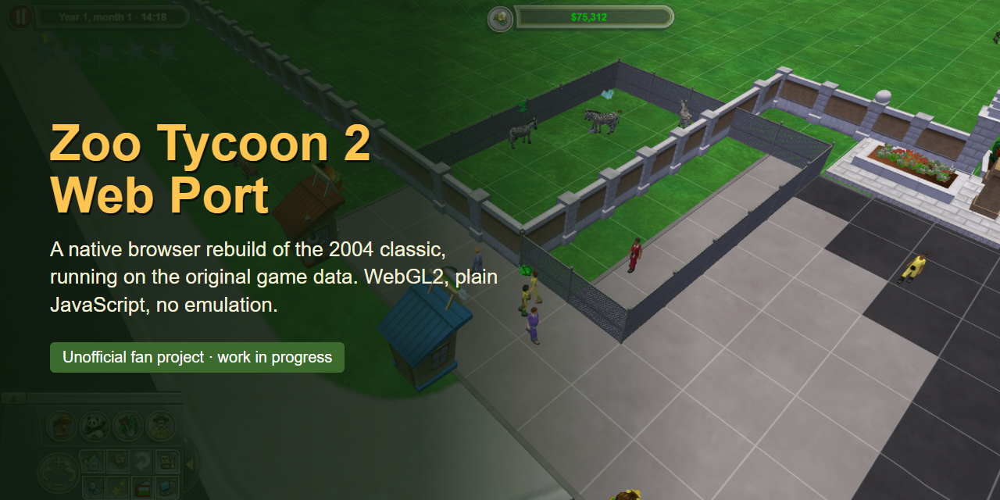

# Zoo Tycoon 2 Web Port

A from-scratch rebuild of **Zoo Tycoon 2: Ultimate Collection** that runs natively in the browser. It
reads the original game's data (models, animations, textures, AI tasks, interface layouts, text)
straight from your own copy of the game and plays it with a new engine written in plain JavaScript
and WebGL2. There is no emulation, no streaming and no third-party code.

> **Unofficial fan project, work in progress.** Not affiliated with or endorsed by Microsoft. This
> repository contains **no game files**: to play you need your own legal copy of Zoo Tycoon 2:
> Ultimate Collection. Zoo Tycoon is a trademark of Microsoft Corporation.

The goal is a 1:1 port: everything that can be read from the game's own files is read from them,
and everything else is checked against the original. Approximations are marked `APPROX` in the code.

## Screenshots

| | |
|---|---|
| 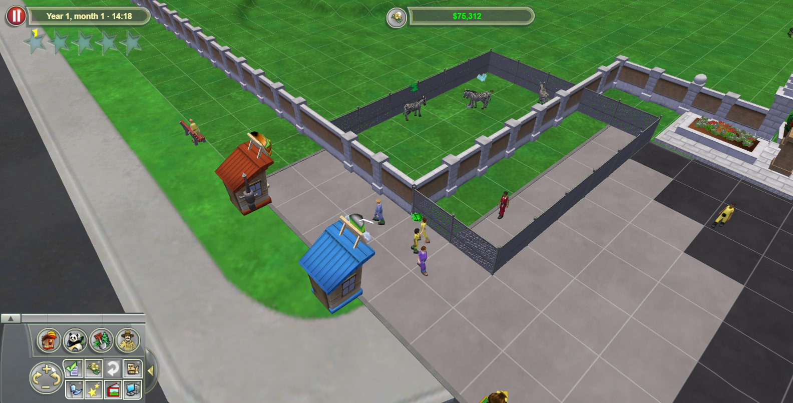 | 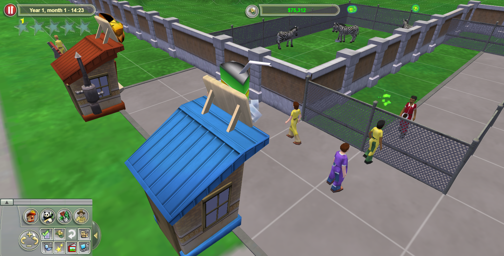 |
| Guests visiting a zebra exhibit, with food stands | Guests walking the paths |
| 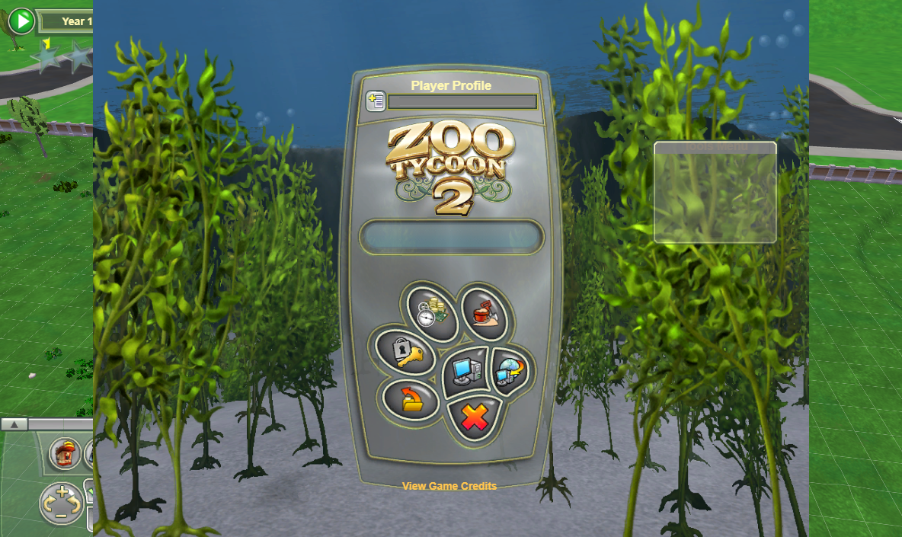 | 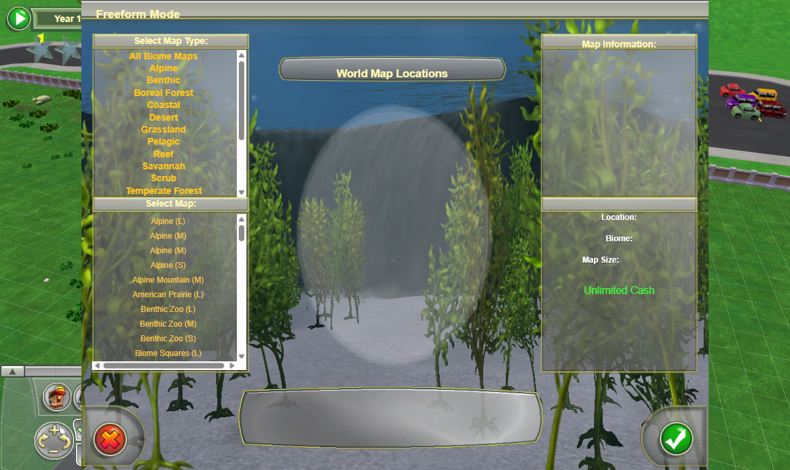 |
| The original main menu | Freeform map selection |
| 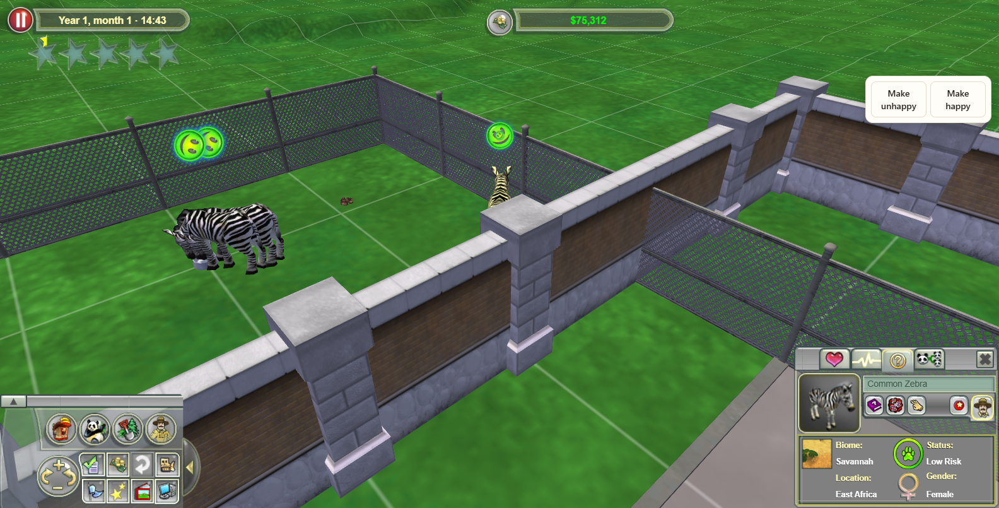 | 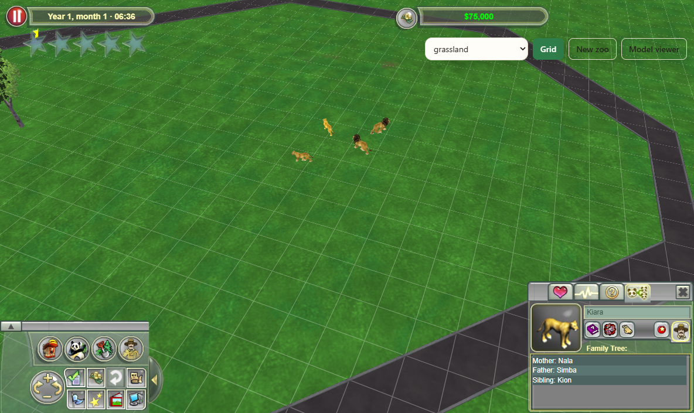 |
| Animal info: biome, region, conservation status | Animal family tree |
| 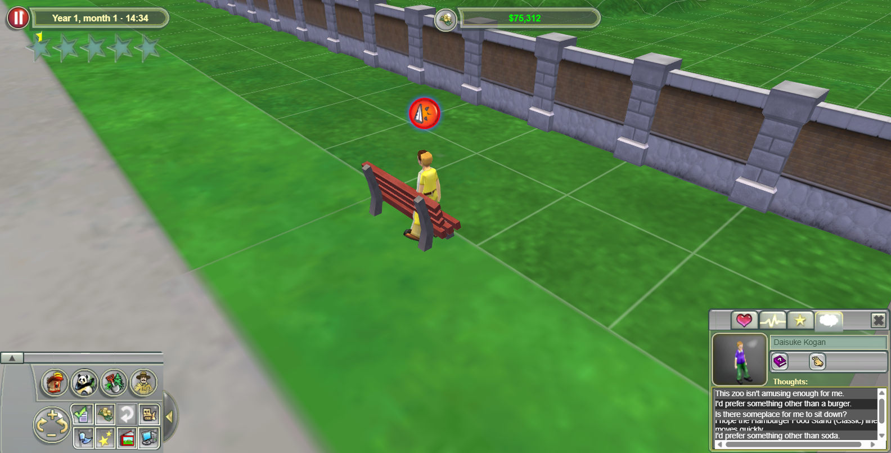 | 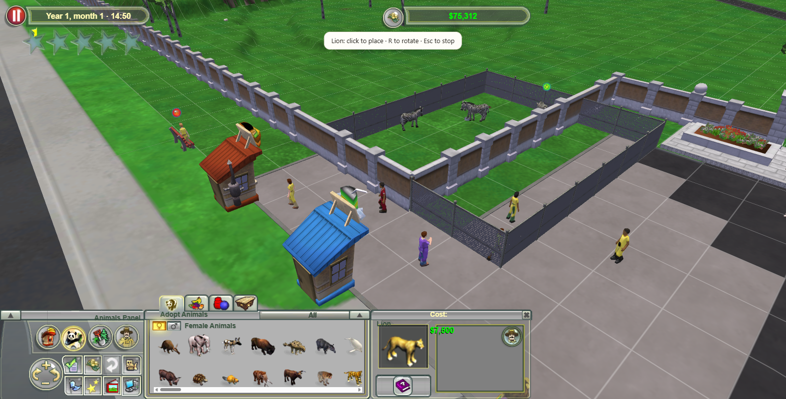 |
| A guest's thoughts | Adopting an animal |
| 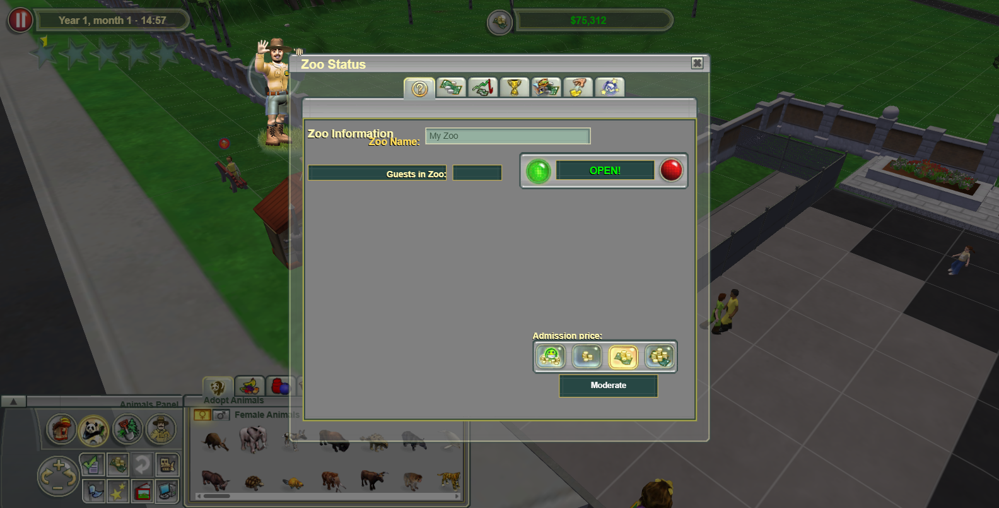 | 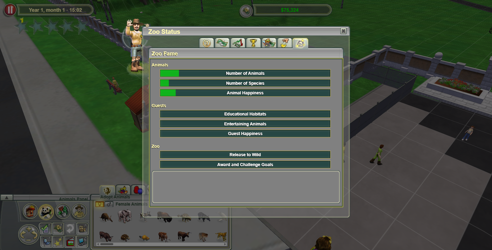 |
| Zoo Status window | Zoo fame breakdown |
| 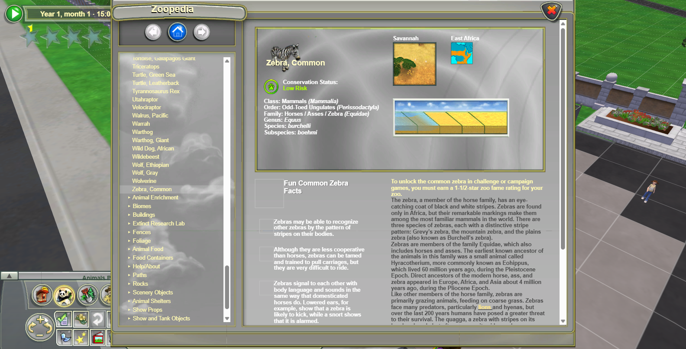 | |
| The Zoopedia | |

## What works

- **Game data**: the `.z2f` archives, NIF and BFB models, BF animations with GPU skinning, DDS
  textures, entity definitions with type inheritance, particle effects (emoticons), the game's
  compiled Lua scripts (read with a small Lua 5.0 disassembler).
- **Terrain and world**: the original maps with their heights, biome painting, cliffs, water,
  sky and time of day; raise, lower, smooth, flatten, cliff, ditch and each biome's water and
  ground brushes.
- **Building**: fences and gates, paths with curbs, buildings, scenery, foliage and rocks with the
  original placement rules, prices, refunds and upkeep.
- **Animals**: every species animates and runs the original AI tasks: needs, eating, drinking,
  sleeping, socialising, breeding and young growing up, sickness, swimming, escaping and fence
  breaking, predators hunting prey.
- **Guests**: they arrive by the original guest manager rules, pay admission, walk the paths and
  run the original guest AI: watching animals (with the original reactions), buying and eating at
  stands and carts, resting on benches, restrooms, telescopes, kiddie rides, donations, litter,
  thoughts, and leaving when their departure points run out. Zoo fame uses the original formula.
- **Interface**: the game's own layout files drive the screens: splash, main menu, map selection,
  the in-game shell with its build panels, info and buy panels, Zoo Status (finances, balance
  sheet, graphs, fame), game options, save and load, and the Zoopedia.

Still to come, phase by phase: staff, transport, walk-around modes, game modes (challenges and
campaigns), expansions content, sound, polish and an Android build. The full feature list with its
status is on the progress page (`/?progress` when running locally).

## Running it

You need [Node.js](https://nodejs.org/) (any recent version) and your own Zoo Tycoon 2: Ultimate
Collection installation.

1. Copy the game's `.z2f` archives into a folder named `orgfiles/` in the project root
   (it is git-ignored and never served beyond your own computer).
2. Start the local server: `node tools/serve.mjs 8080`
3. Open <http://localhost:8080/>

`src/config.js` switches where the game files come from:

- `GAME_FILES_MODE = 'local'`: loads `orgfiles/` through the local server (127.0.0.1 only).
- `GAME_FILES_MODE = 'production'`: for a public deployment. Players open their own `.z2f`
  files in the browser; nothing is uploaded and no game files are hosted.

Useful URL options: `?map=<name>` opens a map directly, `?money=<amount>` sets the cash,
`?classic` uses the simple development menu instead of the original interface, `?debug` exposes
the game state as `window.zt2Debug` for testing, `?progress` shows the progress page.

## Development

- No build step and no dependencies: plain ES modules in `src/`, served as they are.
- `viewer.html` is a model and animation viewer for the game files.
- `tools/` has inspection tools (archive listing and search, NIF/BFB dumps, the Lua disassembler)
  and `tools/playtest.mjs`, which drives a headless Chrome with real mouse input to play-test
  scenarios and take screenshots.

## Credits

- [OpenZT2](https://github.com/overyonder/openzt2) (MIT License, Copyright (c) 2026 OpenZT2
  contributors) was a reference for several file formats and engine details; code adapted from it
  is marked in the source files.
- Zoo Tycoon 2 and all of its content belong to Microsoft Corporation and its original developers.
